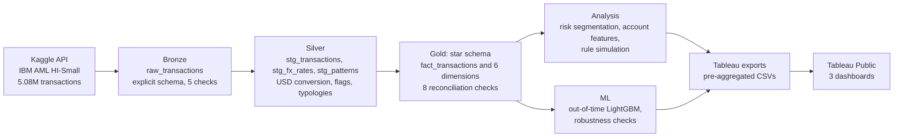

# AML Transaction Monitoring Analytics

Can a machine learning model catch more money laundering than rule-based alerts, given the same analyst workload?

This project analyses 5.08M transactions end to end: data engineering, statistical risk analysis, rule simulation, an out-of-time ML model and interactive Tableau dashboards.

- [Live dashboards on Tableau Public](https://public.tableau.com/app/profile/chanindu.dahanayake/viz/AMLTransactionMonitoringAnalytics/D1ExecutiveRiskOverview)
- [Decision log (28 design decisions)](docs/decision_log.md)
- [Tableau data dictionary](docs/tableau_data_dictionary.md)

## Results

| Metric | Best rule (R3: ACH concentration) | LightGBM model | Change |
|---|---|---|---|
| Laundering accounts caught (6,348 alerts) | 285 | 891 | 3.1x (bootstrap 95% CI 2.7x to 3.4x) |
| Precision | 4.5% | 14.0% | 3.1x |
| Recall | 8.5% | 26.5% | 3.1x |
| Analyst cost per catch ($20 per alert) | $445 | $142 | -68% |
| Recall on undocumented laundering schemes | 3.7% | 16.7% | 4.5x |

The model was trained on Sep 1-5 and tested on Sep 6-10, and each comparison uses the same number of alerts. At each individual rule's alert volume, the model catches 2.3x to 4.7x more laundering accounts.

## Key findings

1. **ACH carries 85% of laundering at 7.2x the base rate.** Saudi Riyal transfers are 3.8x riskier. Rates use Wilson 95% confidence intervals with Bonferroni correction.
2. **Laundering continues through the weekend.** The weekend rate is about 2.2x the weekday rate and reaches 5x in weekend business hours, because legitimate volume drops while laundering does not.
3. **No structuring below $10K.** Risk concentrates in the $1K to $50K band (up to 3.6x), so a single "amount above X" threshold is the wrong rule design.
4. **43% of laundering matches no documented typology.** Most rules lose power on these unknown schemes. Only inflow-based rules hold up.
5. **No single behaviour separates launderers well.** The best single feature reaches AUC 0.73. The model's value comes from combining features: a model on the top 5 features alone scores PR-AUC 0.064, against 0.183 for the full model.
6. **Combining rules does not solve it.** Six standard rules together catch 81% of laundering accounts but alert on 46.5% of all customers, with a 98% false positive rate and about $4.8M of analyst time over 10 days.

## Dashboards

| Dashboard | Question | Contents |
|---|---|---|
| D1 Executive Risk Overview | Where is the risk? | KPI tiles, lift with confidence intervals, hour by day heatmap, amount band risk |
| D2 Laundering Behaviour | What does laundering look like? | Typology profile, feature AUC ranking, rule coverage by typology |
| D3 Rules vs ML What-If | What if a model chose the alerts? | Alert budget and cost sliders driving live KPIs, capacity curve, rules vs model at equal workload |

## Architecture



Stack: Python, DuckDB, SQL, pandas, scikit-learn, LightGBM, Tableau

## Pipeline

| Script | Purpose |
|---|---|
| `01_load_raw.py` | Load the raw CSV into DuckDB with an explicit schema and run data quality checks |
| `02_investigate.py` | Check duplicates, self-transfers, implied FX rates and key uniqueness before cleaning |
| `03_build_staging.py` | Build the silver layer: USD conversion, composite keys, flags, typology parsing |
| `04_build_gold.py` | Build the star schema, flag the tail period and run reconciliation checks |
| `05_analysis_risk.py` | Segment risk with Wilson CIs, lift, two-proportion z-tests and Bonferroni correction |
| `06_account_behaviour.py` | Build 15 account-level features, rank them by AUC and check them against known typologies |
| `07_rule_simulation.py` | Simulate 6 rules plus a control rule, apply the cost model, sweep thresholds |
| `08_ml_vs_rules.py` | Compare LightGBM, a logistic regression baseline and the rules at equal alert budgets |
| `09_robustness.py` | Permutation importance, ablation, seed stability and bootstrap confidence intervals |
| `10_export_tableau.py` | Export pre-aggregated Tableau datasets and generate the data dictionary |
| `common.py` | Shared features, model parameters and rules |

## Practices

- Bronze, silver and gold layers, with the raw data never modified
- 18 automated data quality and reconciliation checks that stop the pipeline on failure
- Out-of-time validation, a leakage check in code, and bootstrap confidence intervals on the main result
- Every design choice recorded with the alternatives considered, in the [decision log](docs/decision_log.md)

### Mistakes found and fixed

- **Precision bug.** `DECIMAL(18,2)` silently rounded Bitcoin amounts, creating 389 false duplicates. The investigation step exposed it, and `DECIMAL(24,8)` fixed it.
- **Outlier-driven claim.** An early reading said undocumented laundering held 87% of laundered value. Medians showed this came from a few extreme transactions ($2,380 median against an $11.9M mean).
- **Simulation artifact.** After Sep 10 the laundering rate jumped to 57-73% because the simulation had ended. These days are flagged with a volume-based rule and excluded, and every finding was rechecked without them.
- **Misleading importance.** Gain importance ranked account lifespan first. Permutation importance ranked it ninth, and the model scored higher without it, so it was removed.

## Reproduce

```bash
python3 -m venv .venv && source .venv/bin/activate
pip install -r requirements.txt

# Data (Kaggle API token required, about 454 MB)
mkdir -p data/raw && cd data/raw
kaggle datasets download -d ealtman2019/ibm-transactions-for-anti-money-laundering-aml -f HI-Small_Trans.csv
kaggle datasets download -d ealtman2019/ibm-transactions-for-anti-money-laundering-aml -f HI-Small_Patterns.txt
cd ../..

# Run the pipeline in order
for s in 01_load_raw 02_investigate 03_build_staging 04_build_gold 05_analysis_risk \
         06_account_behaviour 07_rule_simulation 08_ml_vs_rules 09_robustness 10_export_tableau; do
  python scripts/$s.py
done
```

## Limitations

- The data is synthetic, because real AML data is confidential. Some patterns come from the simulator: no laundering in wire or cross-currency transactions, a warm-up period on Sep 1-2, and the post-Sep 10 tail.
- Only 10 days can be analysed, and the weekend effect rests on 3 weekend days.
- The cost model ($20 per alert, 30 minutes at $40 per hour) is an assumption. D3 exposes it as a slider.
- The bootstrap treats accounts as independent. Accounts in the same laundering scheme are correlated, so the true intervals are somewhat wider.
- A possible next step is a graph neural network over the transaction network.

## Data

[IBM Transactions for Anti Money Laundering](https://www.kaggle.com/datasets/ealtman2019/ibm-transactions-for-anti-money-laundering-aml), HI-Small variant, licensed under CDLA-Sharing 1.0. The data files are not included in this repository.

## Author

Chanindu Dahanayake, B.Sc. (Hons) IT & Management, University of Colombo. [LinkedIn](https://linkedin.com/in/chanindu), chanindudaha@gmail.com
